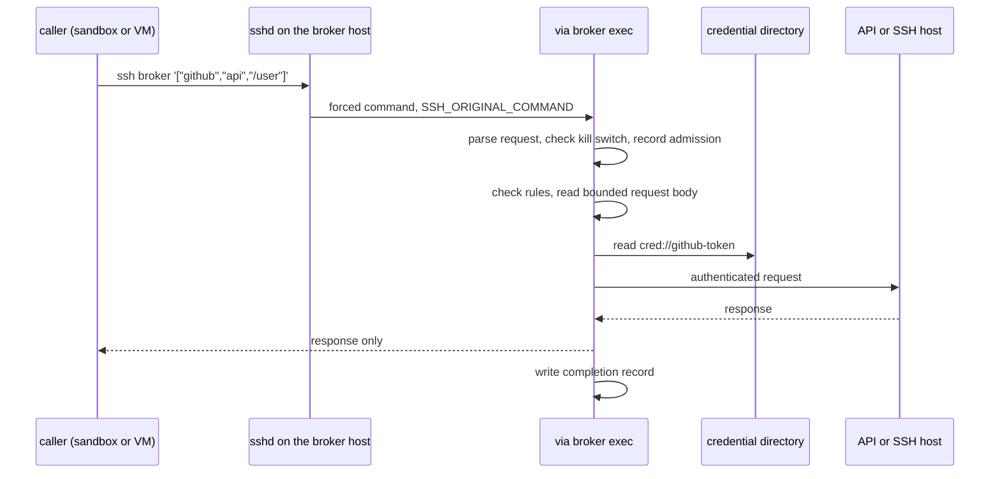

# Broker Mode

Broker mode runs via on a trusted host for a caller on another machine or
VM. The caller is untrusted: for example, an AI coding agent in a sandbox.

The caller connects over SSH with a key that can do one thing: run
`via broker exec`. via executes the requested capability on the trusted host
and returns only the result. The caller never holds a credential.



## Threat Model

| Party | Trust | What it can do |
| --- | --- | --- |
| Broker host | Trusted | Holds credentials, the broker config, and the audit trail. |
| Caller | Untrusted | Sends requests. It may be compromised or follow hostile instructions. |
| Caller's SSH key | Low value | Grants "run via capabilities" on the broker, nothing else. |

Broker mode is built to hold these properties against the caller:

- It cannot read a credential, or choose which credential a request uses.
- It cannot read or write a file on the broker host.
- It cannot run a program on the broker host, other than the fixed OpenSSH
  client of a configured `ssh` capability.
- It cannot choose the config, change the rules, or skip the audit record.
- Every request it makes leaves a record, including refused requests.

Broker mode does not protect against these cases:

- A response that contains a credential. See
  [Calls that return secrets](#calls-that-return-secrets).
- Harm that an allowed request can do. A caller that may `POST` to an
  endpoint can send any body to it. via does not inspect request bodies or
  query strings.
- An `ssh` capability is remote shell access as the configured user. The
  caller can read whatever that user can read on the allowed hosts.
- A compromised broker host or broker account.

Keep each capability as narrow as its task. Use method and path rules, a
credential with the smallest scope the service offers, and one broker key per
caller so that a key can be revoked alone.

## Set Up The Broker Host

### 1. Create a broker account and config

Create a dedicated account with no other duties, such as `via-broker`. sshd
starts a forced command through the account's login shell, so the account
needs a working shell such as `/bin/sh`. Disable its password.

Store the config where the caller's requests cannot change it:

```sh
sudo install -d -m 0755 /etc/via
sudo install -m 0644 examples/broker.toml /etc/via/broker.toml
```

[examples/broker.toml](../examples/broker.toml) is a complete config. Check
it from the broker account before you allow a caller in:

```sh
sudo -u via-broker via --config /etc/via/broker.toml config doctor
```

### 2. Provide credentials with the directory provider

The `directory` provider reads each credential from one file. It needs no
desktop app, login or daemon.

```toml
[providers.files]
type = "directory"
path = "/run/credentials/via-broker-credentials.service"

[services.github.secrets]
token = "cred://github-token"
```

A reference is `cred://<name>`. `<name>` is a single file name in the
directory: it cannot be empty, `.` or `..`, and cannot contain `/`, `\` or a
NUL byte.

via refuses a credential file when any of these is true:

- It is a symbolic link to a file outside the directory, or to a file in a
  subdirectory.
- It is not a regular file.
- It is readable or writable by "other" users (mode `& 0o006`). Use mode
  `0400` or `0600`.
- It is larger than 1 MiB or is not valid UTF-8.

via strips exactly one trailing newline, and a carriage return before it.
It never prints a value or includes one in an error.

via pins the credential directory while it opens a file. File resolution stays
inside that directory, even if another process replaces a checked path.

When `path` is absent, via uses the `CREDENTIALS_DIRECTORY` environment
variable. systemd sets that variable for a unit that uses `LoadCredential=`
or `LoadCredentialEncrypted=`, so a unit that runs via directly needs no
`path`.

An SSH forced command is not started by such a unit. For broker mode, keep
a small unit active that owns the decrypted credentials, and point `path` at
its credential directory:

```ini
# /etc/systemd/system/via-broker-credentials.service
[Unit]
Description=Decrypted credentials for the via broker

[Service]
Type=oneshot
RemainAfterExit=yes
User=via-broker
LoadCredentialEncrypted=github-token:/etc/via/credstore/github-token.cred
LoadCredentialEncrypted=deploy-ssh-public-key:/etc/via/credstore/deploy-ssh-public-key.cred
ExecStart=/usr/bin/true

[Install]
WantedBy=multi-user.target
```

Encrypt each credential for the host. `systemd-creds` reads the value from
standard input here, so it does not enter shell history:

```sh
sudo install -d -m 0700 /etc/via/credstore
sudo systemd-creds encrypt --name=github-token - /etc/via/credstore/github-token.cred
sudo systemctl enable --now via-broker-credentials.service
```

While the unit is active, systemd keeps the decrypted files in
`/run/credentials/via-broker-credentials.service/`. Confirm that the broker
account, and no other account, can read them:

```sh
sudo -u via-broker ls -l /run/credentials/via-broker-credentials.service/
```

Any directory that meets the file rules above works. Another secret manager
can write the files instead of systemd.

`bearer`, `headers` and `github_app` auth work with the directory provider.
`oauth` auth also works: it sends the resolved credential bundle to the local
via daemon, which the broker account must be able to start. The daemon keeps
OAuth state only in memory, so prefer a `client_credentials` bundle. A rotated
refresh token is lost when the daemon exits.

### 3. Prepare SSH capabilities

Skip this step if the broker config has no `ssh` capability.

An `ssh` capability needs an SSH agent on the broker host that holds the
private key. Set the profile's `agent_socket` to that agent's socket, and
store the matching public key as a credential file:

```toml
[ssh_profiles.deploy]
provider = "files"
public_key = "cred://deploy-ssh-public-key"
agent_socket = "/run/via-broker/ssh-agent.sock"
```

via reads only the public key. It asks the agent for that one identity, so
the private key never enters via or the caller's session.

In broker mode via runs OpenSSH with `StrictHostKeyChecking=yes` and
`UpdateHostKeys=no`. OpenSSH refuses a host whose key is not in `known_hosts`
and never asks the caller to accept one, even when the caller's key has `pty`.
A server cannot add keys either. Add each allowed host's key to the broker
account's `known_hosts` file before the first request.

OpenSSH joins the remote command's arguments with spaces and the remote
shell parses the result, as it does for a local `ssh` command. via refuses a
remote command that starts with `-`, so it cannot be read as an OpenSSH
option.

### 4. Force the command for the caller's key

Add the caller's public key to the broker account's `authorized_keys` with a
forced command and `restrict`:

```text
command="/usr/local/bin/via broker exec --config /etc/via/broker.toml --caller sandbox-1",restrict ssh-ed25519 AAAA... sandbox-1
```

`restrict` turns off port, agent and X11 forwarding, PTY allocation and
`~/.ssh/rc`. `command=` makes sshd run via no matter what the caller asks
for. sshd passes the caller's requested command to via in
`SSH_ORIGINAL_COMMAND`.

Use an absolute path for both the via binary and the config. `--caller` is a
label of your choice. via writes it to every audit record from this key.

If an interactive session through an `ssh` capability needs a terminal, add
`pty` after `restrict`. Grant `pty` only to a key that needs it: with a
terminal, a disconnect or an interrupt key can end via before it writes the
completion record. The admission record remains.

Harden sshd for the broker account:

- Keep `authorized_keys` owned by root or outside the account's control,
  for example with `AuthorizedKeysFile /etc/ssh/authorized_keys/%u`.
- Do not accept caller-set environment. Leave `PermitUserEnvironment` at its
  default of `no`. Do not add an `AcceptEnv` entry that matches `VIA_*`,
  `CREDENTIALS_DIRECTORY`, `HOME`, `PATH` or `XDG_RUNTIME_DIR`.
- Give each caller its own key and `--caller` label.

via reads these variables, so a caller that could set them could change
where via looks for credentials, caches and its daemon.

## Call The Broker

The request is the argument list that the caller would pass to a local via.
It must be a JSON array of strings. via does not split shell words, so
quoting on the caller's side cannot change what the broker runs.

```sh
ssh via-broker@broker.example.com '["capabilities","--json"]'
ssh via-broker@broker.example.com '["github","api","/repos/OWNER/REPO/issues","--query","state=open"]'
```

A small shim on the caller's side keeps the usual command shape. Save it as
`via` on the caller's `PATH`:

```sh
#!/bin/sh
# Forward the argument list to the via broker as a JSON array.
exec ssh -T -o BatchMode=yes via-broker@broker.example.com \
  "$(jq -cn '$ARGS.positional' --args -- "$@")"
```

The `--` after `--args` stops jq from reading request options such as
`--json` as its own. Without jq, Python does the same job:

```sh
"$(python3 -c 'import json, sys; print(json.dumps(sys.argv[1:]))' "$@")"
```

With the shim in place, the caller runs via as usual:

```sh
via capabilities --json
via skill print
via github api /repos/OWNER/REPO/issues --query state=open
echo '{"title":"Example"}' | via github api POST /repos/OWNER/REPO/issues --json @-
via github api /repos/OWNER/REPO/contents/README.md --output - > readme.json
via servers shell app-01.example.com uptime
```

via limits a request to 64 KiB and 256 arguments, and refuses a NUL byte.
Send a larger body on standard input with `--json @-` or `--data @-`.
The body limit is 8 MiB, with a 30-second deadline to receive the body and EOF.
via checks the method, path, and asset origin before reading the body.

Exit codes match a local via. `0` means success. `2` means that the request
was refused, was invalid, or received an HTTP error status. `1` means another
failure, such as a network error. An `ssh` capability returns the remote
command's exit code.

### Test a broker config locally

Pass the request after `--` instead of using `SSH_ORIGINAL_COMMAND`:

```sh
via broker exec --config /etc/via/broker.toml --caller test -- capabilities --json
```

via refuses a request that arrives both ways, or neither way. This form
applies every broker restriction and writes an audit record.

## What Broker Mode Refuses

Broker restrictions are part of the `broker exec` entry point. No part of a
request and no environment variable can turn them off.

| Request | Result | Why |
| --- | --- | --- |
| `capabilities`, `capabilities --json`, `skill print` | Allowed | The caller needs to discover what it may use. |
| `<service> <capability> ...` for `rest` and `ssh` | Allowed | These modes keep the credential inside via or the SSH agent. |
| `<service> <capability> ...` for `delegated` | Refused | A delegated child receives the secret and runs on the broker host with the caller's arguments. |
| `config`, `login`, `daemon`, `doctor`, `version`, `broker`, options such as `--config` | Refused | They inspect or change the broker host, or select another config. |
| `--json @file`, `--data @file` | Refused | They read a file on the broker host. Use `@-` for standard input, or pass the body inline. |
| `--output <path>` | Refused | It writes a file on the broker host. Use `--output -` for standard output. |

Other differences from a local via:

- `capabilities` and `skill print` leave out delegated capabilities, and
  any service that has only delegated capabilities.
- via does not follow HTTP redirects. A redirected request fails and reports
  the status and the `Location` target. A redirect could otherwise carry a
  secret header to another host, or reach a path that the rules deny.
- The config comes only from `--config` in the forced command. via ignores
  `VIA_CONFIG`, `./via.toml` and the default config location.
- A service name must be a single path component.
- Every REST request path must be in [normal form](#path-normal-form), even
  for a capability without rules. A path such as `/../other` cannot leave the
  path of `base_url`, and the audit record names the path that via sent.

`--output -` writes the raw response bytes to standard output. via redacts
known secret values from those bytes. An absolute asset URL still needs
`--output`, so use `--output -` for an asset download through the broker.
Broker asset URLs require HTTPS without user information. Port 443 is allowed
for listed asset hosts. Another port requires the exact HTTPS origin in `base_url`.
These restrictions apply before credentials are resolved or sent.

## Method And Path Rules

Rules narrow a `rest` capability. They apply in every mode, not only in
broker mode.

```toml
[services.github.commands.api]
mode = "rest"
base_url = "https://api.github.com"
methods = ["GET"]
allow_paths = ["/user", "/repos/OWNER/**"]
deny_paths = ["/repos/*/*/actions/secrets/**"]
```

This capability can read the authenticated user and one owner's repositories,
except their Actions secrets. It cannot change anything.

| Field | Meaning |
| --- | --- |
| `methods` | Only these HTTP methods are allowed. The comparison ignores case, and via sends the method name in upper case. |
| `allow_paths` | When not empty, the request path must match at least one pattern. |
| `deny_paths` | A match refuses the request. Deny wins over allow. |
| `rules` | Optional finer rules that pair methods with one path pattern. |

A capability with none of these fields behaves as before.
Unknown REST field names are rejected. A misspelled policy field cannot silently disable its restriction.

### Patterns

A pattern is a list of `/`-separated segments:

| Segment | Matches |
| --- | --- |
| `*` | Exactly one segment. |
| `**` | The rest of the path, including nothing. Valid only as the last segment. |
| anything else | That literal segment, compared after percent-decoding the request segment. |

`/repos/OWNER/**` matches `/repos/OWNER` and everything below it. It does
not match `/repos/OWNER-2`. One trailing slash is not significant:
`/admin` and `/admin/` match the same patterns.

Write a literal segment in its decoded form. via does not decode a pattern:
`/files/a b` matches the request path `/files/a%20b`, and `/files/a%20b`
does not.

Patterns apply to the request path relative to `base_url`. An absolute URL
on the `base_url` host whose path starts with the `base_url` path is the same
request, so via matches it the same way: against the part after the
`base_url` path. For any other absolute asset URL, patterns apply to the whole
URL path. Add an asset host only if every allowed pattern is also safe on
that host.

A pattern may not contain `?` or `#`.

### Finer rules

A `rules` entry applies to its `path`, and only to its `methods` when that
field is set. Use it to allow writes on fewer paths than reads:

```toml
[services.github.commands.api]
mode = "rest"
base_url = "https://api.github.com"
methods = ["GET", "POST", "PATCH"]

[[services.github.commands.api.rules]]
methods = ["GET"]
path = "/repos/OWNER/**"
effect = "allow"

[[services.github.commands.api.rules]]
methods = ["POST", "PATCH"]
path = "/repos/OWNER/*/issues/**"
effect = "allow"

[[services.github.commands.api.rules]]
path = "/repos/*/*/actions/secrets/**"
effect = "deny"
```

via evaluates a request in this order:

1. The request path must be in normal form. See the next section.
2. If `methods` is set, it must contain the request method.
3. If the path matches `deny_paths`, or a `rules` entry with
   `effect = "deny"` matches the method and path, via refuses the request.
4. If `allow_paths` is not empty, or any `rules` entry has
   `effect = "allow"`, the request must match one of them. A match in
   `allow_paths` allows every method that step 2 allows.
5. Otherwise via allows the request.

### Path normal form

Rules only mean something if the path that via checks is the path that the
service acts on. When any rule field is set, and for every request in broker
mode, via refuses a request target that a client or server could rewrite:

- A `.` or `..` segment, written plainly or percent-encoded, such as `%2e%2e`.
- An empty segment, such as `//`.
- A backslash, or an encoded slash or backslash: `%2f`, `%5c`.
- Plain whitespace, or a control character, plain or encoded. Write a space
  as `%20`.
- A malformed percent escape.

The backslash, whitespace and control character checks also cover a query
string that is written into the target. Pass query parameters with `--query`
and via encodes them.

via also parses the final URL and refuses the request unless it carries
exactly the checked path to the expected host. Redirects are not followed
for a capability with rules.

Rules cover the method and the path. They do not cover the query string, the
request body, or how the service interprets them. Prefer `allow_paths` to
`deny_paths`: a deny list depends on the service treating paths the way via
does. Some services ignore case, accept `;parameters` in a segment, or let a
query parameter or body field override the method. A GraphQL endpoint is one
path for every operation, so path rules cannot separate its operations.

`via capabilities --json` reports the rules of each capability under a `rest`
key, and `via skill print` lists them, so an agent can see what it may call.

## Calls That Return Secrets

via keeps the configured credential out of the caller's reach. It cannot
know that a response carries a different credential.

Deny every endpoint whose response contains a secret:

- Token creation and exchange, such as installation tokens, registration
  tokens, personal access tokens, and OAuth token endpoints.
- Secret stores, such as CI secrets and variables, deploy keys, and webhook
  configurations that echo their secret.
- Endpoints that echo request headers.
- Pre-signed download URLs, when the file behind them is sensitive.

via redacts the resolved credential from text it prints, including the
`--output -` stream and error bodies. Redaction is exact matching. It does
not catch an encoded or transformed copy, so treat it as a safety net, not a
control. An allow list of known-safe paths is the control.

## Kill Switch

```toml
[broker]
disable_dir = "/etc/via/disabled"
```

Before each request, via checks for marker files in `disable_dir`:

| Marker | Effect |
| --- | --- |
| `<disable_dir>/all` | Refuses every request, including `capabilities`. |
| `<disable_dir>/<service>` | Refuses every capability of that service. |

```sh
sudo touch /etc/via/disabled/all      # stop everything
sudo touch /etc/via/disabled/github   # stop one service
sudo rm /etc/via/disabled/all         # resume
```

A refused request exits with status `2` and prints
`via broker: access is disabled`. It does not say which marker exists. via
writes an audit record for it.

via rejects a config with an unknown top-level table, so a misspelled
`[broker]` table cannot leave the kill switch off without an error.

A missing directory disables nothing. Any other failure to check a marker,
such as a permission error, counts as disabled. The broker account needs
search permission on the directory and should not be able to write to it. A
marker takes effect on the next request. It does not stop a request that is
already running.

## Audit Records

`broker exec` requires an `[audit]` table. via opens the sink before it runs
a request. It must also write an admission record before starting an accepted request.
If either operation fails, via refuses the request.

```toml
[audit]
sink = "journald"
```

```toml
[audit]
sink = "file"
path = "/var/log/via/audit.jsonl"
```

| Sink | Behavior |
| --- | --- |
| `journald` | Sends one datagram to `/run/systemd/journal/socket` with `MESSAGE=<json>`, `SYSLOG_IDENTIFIER=via`, and `PRIORITY=6`, or `5` for a denied or failed request. Unix only. |
| `file` | Appends one JSON line. via creates the file with mode `0600`. The broker account must be able to append to it. |

Read journald records with:

```sh
journalctl -t via -o cat | jq .
```

Accepted requests produce an `outcome = "started"` admission record and a completion record.
The two records share a `request_id`. Rejections before admission produce one completion record.
An admission record without a completion record identifies an unfinished or interrupted request.

Example completion record:

```json
{"ts":"2026-01-02T03:04:05.678Z","request_id":"1234-1767323045496000000","caller":"sandbox-1","client":"198.51.100.7","request":"run","service":"github","capability":"api","mode":"rest","method":"GET","host":"api.github.com","path":"/repos/OWNER/REPO/issues","ssh_host":null,"ssh_command":null,"outcome":"ok","reason":null,"status":200,"duration_ms":182}
```

Every field is always present. A field that does not apply is `null`.

| Field | Content |
| --- | --- |
| `ts` | Record time, RFC 3339 in UTC. |
| `request_id` | Correlates admission and completion records for one process request. |
| `caller` | The `--caller` label. |
| `client` | The first field of `SSH_CONNECTION`: the caller's address. |
| `request` | `capabilities`, `skill` or `run`. `null` when via could not accept the request as one of these. |
| `service`, `capability` | The names from a `run` request, as the caller sent them. |
| `mode` | `rest`, `ssh` or `delegated`, once via has found the capability. |
| `method`, `host`, `path` | The HTTP method, target host, and path of a `rest` request. The path has no query string. |
| `ssh_host`, `ssh_command` | The host of an `ssh` request and its remote command joined with spaces, cut to 512 bytes. `ssh_command` is `null` for an interactive session. |
| `outcome` | `started`, `ok`, `denied` or `error`. |
| `reason` | A short code for a `denied` or `error` outcome. |
| `status` | The HTTP status, or the exit code of the SSH client. |
| `duration_ms` | Time spent on the request. |

via cuts `ssh_command` at 512 bytes and every other text field at 2048 bytes.
A cut value ends with `...[truncated; N bytes]`, where `N` is its full
length. Treat a truncated `ssh_command` as unreviewed: the record does not
show all of what ran.

`denied` reasons:

| Reason | Meaning |
| --- | --- |
| `disabled` | The kill switch is on. |
| `invalid_request` | The request was missing, not a JSON array of strings, or over a limit. |
| `request_not_allowed` | The request was not discovery or a capability invocation. |
| `invalid_service_name` | The service name was not a single path component. |
| `delegated_not_allowed` | The capability is delegated. |
| `local_file_input`, `local_file_output` | The request used `@file` or `--output <path>`. |
| `method_not_allowed`, `path_denied`, `path_not_allowed` | A method or path rule refused the request. |
| `path_not_normalized` | The request path is not in normal form. |
| `asset_host_not_allowed`, `ssh_host_not_allowed` | The host is not listed for the capability. |
| `ssh_option_not_allowed` | The remote command of an `ssh` request starts with `-`. |
| `asset_origin_not_allowed` | An asset URL uses an unapproved scheme, port, or user information. |
| `body_too_large`, `body_timeout` | Standard input exceeds 8 MiB or does not finish within 30 seconds. |

`error` reasons include `http_status` for a response outside the 2xx range,
`unknown_service`, `unknown_capability`, `secret_unavailable`,
`ssh_command_failed` and `http_error`.

A record never contains a query string, a request or response body, a header
value, or a value from a provider. via redacts resolved secrets from every
field and limits each field's length.

Admission records omit targets and command arguments because secrets are not yet available for redaction.
Completion records include the sanitized execution details.

A completion record that cannot be written cannot undo the request. via then exits with status `1` and
reports the audit failure, even if the request succeeded. Watch for that
error, and keep the audit file's volume from filling up.

A caller that stops reading cannot prevent the admission record.
Without a terminal, a disconnect lets via record the output failure with an `io_error` reason.

## Configuration Reference

| Table | Field | Value |
| --- | --- | --- |
| `[providers.NAME]` | `type` | `"directory"` |
| | `path` | Absolute directory. Optional: defaults to `CREDENTIALS_DIRECTORY`. |
| `[services.S.commands.C]` | `methods` | Allowed HTTP methods. |
| | `allow_paths`, `deny_paths` | Path patterns. |
| `[[services.S.commands.C.rules]]` | `methods`, `path`, `effect` | Optional methods, one pattern, `"allow"` or `"deny"`. |
| `[broker]` | `disable_dir` | Absolute directory for kill switch markers. Optional. |
| `[audit]` | `sink` | `"journald"` or `"file"`. |
| | `path` | Absolute file path. Required for `file`. |

`[broker]` and `[audit]` only affect `via broker exec`. A local via reads
and validates them, and otherwise ignores them.
